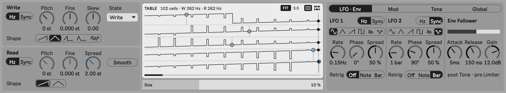
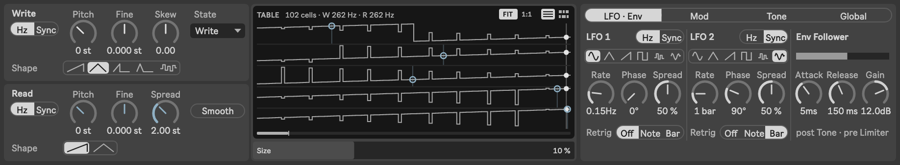
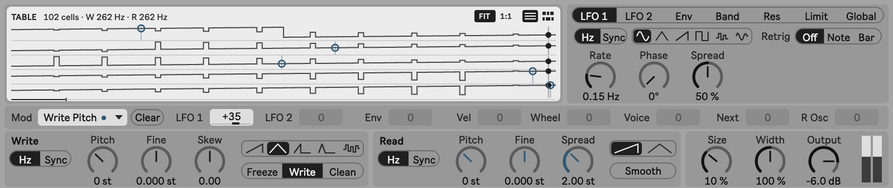
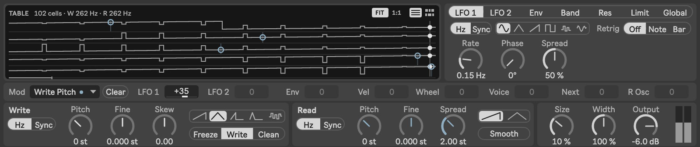

# Aliasing

| | Light theme | Dark theme |
|---|---|---|
| **Aliasing A** |  |  |
| **Aliasing B** |  |  |

<sub>Preview renders of the device files (default page), drawn outside Live by
`test/preview/readme_images.py`; screenshots from Live replace them with version 1.0.</sub>

**Aliasing** is a five-voice drone synthesizer for Ableton Live (a Max for Live instrument) whose sound
is made of errors. Every voice writes into an audio table and reads it back at the same time, but at
different, "careless" speeds; what the reader finds there was written at the wrong moment, and those
mistakes are the sound: buzzing, stepped, glitching waveforms that change drastically with the
smallest move of either speed. Filters, a resonator and a colouring limiter shape it from bizarre to
atmospheric. Version **0.3.0-beta.1** comes in two faces, A and B, with the same sound.

## What it does

- **The table.** Each of the five voices owns one row of 1024 cells. A **write pointer** stores, at its
  position, where the voice's **read pointer** currently is (its phase); the read pointer plays back
  what it finds. Both pointers have their own pitch (−64 … +130 semitones around middle C, plus a fine
  control in 0.001 st steps) or run in sync with Live's tempo (note value × N ÷ D). **Size** limits
  both pointers to a part of the row (0.1 … 100 %), **Read Spread** fans the five voices' read pitches
  apart.
- **Writing.** The **Write Shape** sets the path of the write head: Ramp, Tri, Pulsar and Spike
  (bursts with pauses in between), Noise (random cells). **Sym** bends the shape (its label follows the
  shape: Curve, Skew, Duty, Width, Smooth). **Write State**: *Freeze* keeps the table as it is, *Write*
  lets the write head change it, *Clean* writes exactly where the reader reads, so the voice plays the
  plain read waveform (ramp or triangle) and the table heals.
- **Modulation.** Two LFOs, an envelope follower on the device's own output, velocity, the mod wheel and
  three audio-rate sources (each voice's own output, its neighbour's output and its read oscillator)
  reach nine targets through an 8 × 9 **mod matrix**. The audio-rate and follower sources are feedback
  loops: the errors modulate the errors.
- **Tone and output.** Per voice: **Drive** (soft saturation), **Band** (band-pass or band-reject with
  resonance, audio-rate FM and a spread of the centre across the voices) and a **Resonator** (a comb that
  can follow each voice's read pitch). Then the stereo mix (**Width**), **Output**, a 5 Hz DC blocker and
  the **Color limiter** (gain, saturation tilted towards lows or highs, release, ceiling; zero latency).
- **The display.** It shows the five rows with their write and read heads, as lines or as a 2D image.
  You can **draw into it**: drag in a lane to draw that voice's row, Shift draws all five, Alt draws a
  straight line, a double-click resets the row to a plain ramp (Shift: all rows). The table is saved
  with the Live Set.
- **Sample drop.** Drop an audio file from Live's browser or the Finder onto the display and it becomes
  the table of all five voices: **FIT** (pill in the display header) resamples the whole file (up to
  10 minutes) into the 1024 cells, **1:1** takes its first 1024 samples. The drop switches Write State
  to Freeze, so the sample stays; switch to Write and the write head eats it.
- **Drone or MIDI.** By default (Gate *Drone*) the device sounds as soon as it is loaded. With Gate
  *MIDI* it sounds while a note is held, and every note-on restarts the pointers. Notes do not set the
  pitch; their velocity and the mod wheel are modulation sources.

### Quick start

1. **Protect your ears first:** put a limiter after the device and turn the monitors down. Feedback and
   FM into the filters can jump to full scale.
2. Drag *Aliasing A* or *Aliasing B* onto a MIDI track. It drones at once: both pointers at 0 st
   (261.6 Hz), Write Shape Tri, Write State Write.
3. Turn **Write Pitch** and **Write Fine** slowly: the smallest changes matter. Try **Read Pitch** against it.
4. Change **Write Shape** and **Sym**; *Freeze* holds a pattern you like, *Clean* returns to the plain
   waveform.
5. Change **Size** and **Read Spread**; then route LFO 1 to *Write Pitch* in the mod matrix.
6. For notes, set **Gate** to *MIDI* (Global page).

## Install

1. Download `Aliasing-0.3.0-beta.1.zip` from the release
   [Aliasing 0.3.0-beta.1](https://github.com/m9dfukc/m4l-workbench/releases/tag/aliasing-v0.3.0-beta.1)
   (a pre-release) and unzip it: it holds the two frozen devices *Aliasing A* and *Aliasing B*.
2. Put them anywhere Live can browse (e.g. your User Library) and drag one onto a MIDI track.

**Requirements:** Ableton Live 12 with Max for Live (Suite, or Standard with the Max for Live add-on)
and **Max 9**, which Live bundles since 12.2 (the device uses Max's `v8` JavaScript engine). Tested on
macOS with Live 12.4.16 and its bundled Max 9.1.5, and with Max 9.2.1. Not tested: Max 9.0.x (Live
12.2, 12.3), Windows, Push 3 Standalone.

## Two faces: A and B

Both faces run the same DSP and have the same 137 automatable parameters (names, ranges, defaults);
only the layout differs. One of them stays for 1.0; which one you prefer is welcome feedback
([issues](https://github.com/m9dfukc/m4l-workbench/issues)).

- **Aliasing A** (`Aliasing.amxd`, 918 px): the Write and Read rows on the left, the table display with
  the Size slider in the middle, four pages on the right: *LFO · Env*, *Mod* (the whole 8 × 9 matrix,
  one row per target), *Tone* (Drive, Band, Resonator; the display shows the tone curve) and *Global*.
- **Aliasing B** (`Aliasing B.amxd`, 800 px): a wider table display at the top with seven side pages
  (*LFO 1*, *LFO 2*, *Env*, *Band*, *Res*, *Limit*, *Global*); below it a **modulation strip** that shows
  the eight depths of one target, picked in the *Mod* menu (a dot marks every target that is modulated;
  *Clear* sets the shown target's depths to 0); at the bottom a fixed row of dials: Write, Read, Size,
  Width, Output and the output meter.

## Parameters

Every parameter Live can automate, with the name Live shows. The descriptions are the texts of Live's
Info View. The tables between the `params` markers are generated from the device files by
`tools/readme_params.py` (run by `tools/check.sh aliasing`); edit the sentences around them, not the
tables.

### Write (A: top left · B: bottom left)

<!-- params: Write Mode, Write Pitch, Write Rate, Write Mult, Write Div, Write Fine, Write Sym, Write Shape, Write State -->
| Parameter | Range | Default | What it does |
|---|---|---|---|
| Write Mode | Hz · Sync | Hz | Write pointer rate: Hz = free pitch, Sync = note value × N ÷ D × Sync Rate at Live's tempo. |
| Write Pitch | −64 st … +130 st | 0 st | Write pointer pitch in semitones around note 60 (−64 … +130). Above about half the sample rate the pattern depends on the sample rate (44.1 and 48 kHz differ). |
| Write Rate | 8 bars, 4 bars, … 1/64 (19 values) | 1/16 | Sync mode: write pointer note value (bars are 4/4). |
| Write Mult | ×1 … ×128 | ×1 | Sync mode: multiplies the note value's rate by N, so synced write rates reach the audio range. |
| Write Div | ÷1 … ÷32 | ÷1 | Sync mode: divides the rate by D, for odd cycle lengths such as 5/16 that drift against the bar. |
| Write Fine | −1.000 st … +1.000 st | 0.000 st | Fine pitch in semitones; in Sync mode a detune against the tempo grid (Resync re-locks it). |
| Write Sym | −1 … +1 | 0 | The write shape's parameter: Curve (Ramp), Skew (Tri), Duty (Pulsar), Width (Spike), Smooth (Noise). |
| Write Shape | Ramp · Tri · Pulsar · Spike · Noise | Tri | Path of the write head (the read phase is written along it): Ramp, Tri, Pulsar and Spike (bursts, then no writing), Noise (random cells). |
| Write State | Freeze · Write · Clean | Write | Freeze keeps the table, Write lets the write head change it, Clean writes where the read pointer reads (the original's "=read": the plain read waveform; heals the table). |
<!-- /params -->

*Write Pitch* is used in Hz mode, *Write Rate*, *Write Mult* and *Write Div* in Sync mode; the face shows
the controls of the current mode (the same holds for Read and the LFOs). The note values run from 8 bars
to 1/64, with dotted (D) and triplet (T) values: 8, 4, 2, 1 bars, 1/2, 1/2D, 1/2T, 1/4, 1/4D, 1/4T,
1/8, 1/8D, 1/8T, 1/16, 1/16D, 1/16T, 1/32, 1/32T, 1/64.

### Read (A: bottom left · B: bottom middle)

<!-- params: Read Mode, Read Pitch, Read Rate, Read Mult, Read Div, Read Fine, Read Spread, Read Shape, Smooth -->
| Parameter | Range | Default | What it does |
|---|---|---|---|
| Read Mode | Hz · Sync | Hz | Read pointer rate: Hz = free pitch, Sync = note value × N ÷ D × Sync Rate at Live's tempo. |
| Read Pitch | −64 st … +130 st | 0 st | Read pointer pitch in semitones around note 60 (−64 … +130). Above about half the sample rate the pattern depends on the sample rate (44.1 and 48 kHz differ). |
| Read Rate | 8 bars, 4 bars, … 1/64 (19 values) | 1/16 | Sync mode: read pointer note value (bars are 4/4). |
| Read Mult | ×1 … ×128 | ×1 | Sync mode: multiplies the note value's rate by N, so synced read rates reach the audio range. |
| Read Div | ÷1 … ÷32 | ÷1 | Sync mode: divides the rate by D, for odd cycle lengths such as 5/16 that drift against the bar. |
| Read Fine | −1.000 st … +1.000 st | 0.000 st | Fine pitch in semitones; in Sync mode a detune against the tempo grid (Resync re-locks it). |
| Read Spread | 0.00 st … 6.00 st | 2.00 st | Read pitch spread across the 5 voices. |
| Read Shape | Ramp · Tri | Ramp | Read pointer: ramp, or triangle up and down. |
| Smooth | Off · On | Off | Read interpolation: off reads whole cells (raw), on is linear. |
<!-- /params -->

### Table (A: slider below the display · B: dial row)

<!-- params: Size -->
| Parameter | Range | Default | What it does |
|---|---|---|---|
| Size | 0.1 % … 100 % | 10 % | Pointer span: both pointers cover only this part of the table; the display zooms to it. |
<!-- /params -->

At 100 % the pointers run through all 1024 cells of a row; at the default 10 % through 102 of them. The
display zooms to Size; a voice whose span is modulated shows it as a moving edge.

### LFO 1 and LFO 2 (A: LFO · Env page · B: LFO 1 and LFO 2 pages)

<!-- params: LFO 1 Mode, LFO 1 Shape, LFO 1 Rate, LFO 1 Sync Rate, LFO 1 Phase, LFO 1 Spread, LFO 1 Retrig, LFO 2 Mode, LFO 2 Shape, LFO 2 Rate, LFO 2 Sync Rate, LFO 2 Phase, LFO 2 Spread, LFO 2 Retrig -->
| Parameter | Range | Default | What it does |
|---|---|---|---|
| LFO 1 Mode | Hz · Sync | Hz | LFO 1 rate: Hz or a note value. |
| LFO 1 Shape | Sine · Tri · Saw · Square · S&H · Random | Sine | LFO 1 waveform. |
| LFO 1 Rate | 0.01 Hz … 20 Hz | 0.15 Hz | LFO 1 rate in Hz (each voice runs slightly faster or slower: Spread). |
| LFO 1 Sync Rate | 8 bars, 4 bars, … 1/64 (19 values) | 1/4 | LFO 1 note value at Live's tempo. |
| LFO 1 Phase | 0° … 360° | 0° | LFO 1 start phase (used on retrigger). |
| LFO 1 Spread | 0 % … 100 % | 50 % | LFO 1 rate spread across the 5 voices (100 % = ± half an octave). |
| LFO 1 Retrig | Off · Note · Bar | Off | LFO 1 restart: never, on every MIDI note-on, or on every bar while Live's transport runs. |
| LFO 2 Mode | Hz · Sync | Sync | LFO 2 rate: Hz or a note value. |
| LFO 2 Shape | Sine · Tri · Saw · Square · S&H · Random | Random | LFO 2 waveform. |
| LFO 2 Rate | 0.01 Hz … 20 Hz | 0.07 Hz | LFO 2 rate in Hz (each voice runs slightly faster or slower: Spread). |
| LFO 2 Sync Rate | 8 bars, 4 bars, … 1/64 (19 values) | 1 bar | LFO 2 note value at Live's tempo. |
| LFO 2 Phase | 0° … 360° | 90° | LFO 2 start phase (used on retrigger). |
| LFO 2 Spread | 0 % … 100 % | 50 % | LFO 2 rate spread across the 5 voices (100 % = ± half an octave). |
| LFO 2 Retrig | Off · Note · Bar | Bar | LFO 2 restart: never, on every MIDI note-on, or on every bar while Live's transport runs. |
<!-- /params -->

Each voice runs its own copy of both LFOs; *Spread* sets how far their rates differ. The LFOs only act
through the mod matrix.

### Envelope follower (A: LFO · Env page · B: Env page)

<!-- params: Env Attack, Env Release, Env Gain -->
| Parameter | Range | Default | What it does |
|---|---|---|---|
| Env Attack | 0.1 ms … 100 ms | 5 ms | Envelope follower attack (the follower reads the output before the limiter). |
| Env Release | 10 ms … 2000 ms | 150 ms | Envelope follower release. |
| Env Gain | −24 dB … +24 dB | +12 dB | Envelope follower gain: the source is the follower level × this, clipped to 0 … 1. |
<!-- /params -->

The follower listens to the stereo sum after the tone section, Output and the DC blocker, before the
limiter; the face shows its level as a bar.

### Drive and Band (A: Tone page · B: Band page)

<!-- params: Drive On, Drive, Band On, Band Mode, Band Slope, Band Center, Band Width, Band Res, Band FM, Band Spread -->
| Parameter | Range | Default | What it does |
|---|---|---|---|
| Drive On | Off · On | On | Switches the drive section on or off (off = exact bypass). |
| Drive | 0 dB … 24 dB | 0 dB | Saturation before the band (tanh); 0 dB = clean. |
| Band On | Off · On | On | Switches the band section on or off (off = exact bypass). |
| Band Mode | Pass · Reject | Pass | Pass keeps the band, Reject removes it (band-stop). |
| Band Slope | 12 · 24 dB | 24 dB | Band edge slope: 12 or 24 dB per octave. |
| Band Center | 20 Hz … 20000 Hz | 632 Hz | Band centre frequency (Spread fans it across the voices). |
| Band Width | 0.2 oct … 10.0 oct | 10.0 oct | Band width in octaves; 10 = open (practically bypass). |
| Band Res | 0 % … 100 % | 0 % | Resonance at the band edges. |
| Band FM | 0 % … 100 % | 0 % | Audio-rate FM of the band centre from the unfiltered core signal (100 % = ±4 octaves). |
| Band Spread | 0 % … 100 % | 25 % | Band centres across the 5 voices (100 % = ±2 octaves). |
<!-- /params -->

### Resonator (A: Tone page · B: Res page)

<!-- params: Res On, Res Track, Res Freq, Res Feedback, Res Mix -->
| Parameter | Range | Default | What it does |
|---|---|---|---|
| Res On | Off · On | Off | Switches the resonator section on or off (off = exact bypass). |
| Res Track | Off · On | On | Resonator follows each voice's read pointer frequency. |
| Res Freq | 20 Hz … 5000 Hz | 140 Hz | Resonator frequency (inactive while Track follows the read pointer). |
| Res Feedback | −95 % … +95 % | +50 % | Resonator feedback: positive values give peaks (metallic), negative values notches (hollow). |
| Res Mix | 0 % … 100 % | 50 % | Resonator mix. |
<!-- /params -->

### Color limiter (A: Global page · B: Limit page)

<!-- params: Limiter On, Limiter Gain, Saturation, Color, Limiter Release, Ceiling -->
| Parameter | Range | Default | What it does |
|---|---|---|---|
| Limiter On | Off · On | On | Switches the limiter section on or off (off = exact bypass). |
| Limiter Gain | 0 dB … 24 dB | 0 dB | Gain into the limiter. |
| Saturation | 0 % … 100 % | 0 % | Saturation before the limiter (0 = clean). |
| Color | −100 % … +100 % | 0 % | Tilts the saturation: negative values drive the lows harder (warm), positive values the highs (edgy). |
| Limiter Release | 1 ms … 1000 ms | 100 ms | Limiter release. |
| Ceiling | −12 dB … 0 dB | −0.3 dB | The output never goes above this (zero latency). |
<!-- /params -->

### Global (A and B: Global page)

<!-- params: Gate, Resync, Sync, Ramp AA, Transpose, Sync Rate -->
| Parameter | Range | Default | What it does |
|---|---|---|---|
| Gate | Drone · MIDI | Drone | Drone: the voices always run (Live's device switch turns them off). MIDI: sound while a note is held; every note-on restarts the pointers. |
| Resync | Off · 1 · 2 · 4 · 8 | Off | Restarts both pointers every 1, 2, 4 or 8 bars while Live's transport runs (counted from its start), in Hz and in Sync mode. Off: only synced pointers restart, once at the start. |
| Sync | Off · On | Off | Restarts both pointers now. |
| Ramp AA | Off · On | Off | Anti-aliased ramps (PolyBLEP) for both pointers, like the original's oscillators; off = naive. |
| Transpose | −48 st … +48 st | 0 st | Transposes both pointers in Hz mode; greyed while both are synced. |
| Sync Rate | ÷16 · ÷8 · ÷4 · ÷2 · ×1 · ×2 · ×4 · ×8 · ×16 | ×1 | Multiplies every synced pointer rate by a power of two, so synced pointers stay on the grid; greyed while no pointer is synced. |
<!-- /params -->

### Output (A: Global page · B: dial row)

<!-- params: Width, Output -->
| Parameter | Range | Default | What it does |
|---|---|---|---|
| Width | 0 % … 200 % | 100 % | Stereo spread of the 5 voices: 0 mono, 100 even, 200 wide. |
| Output | −36 dB … 0 dB | −6 dB | Output level (the 5-voice sum is compensated by −14 dB). |
<!-- /params -->

### Mod matrix (A: Mod page · B: modulation strip)

<!-- params-matrix -->
**72 parameters** named `<Source> > <Target>` (e.g. `LFO 1 > Write Pitch`), each −100 % … +100 %, default 0 %.

- Sources (8): LFO 1, LFO 2, Env, Velocity, Mod Wheel, Voice, Neighbour, Read Osc
- Targets (9): Write Pitch, Write Sym, Write Gate, Read Pitch, Read Spread, Size, Band Center, Res Freq, Output
<!-- /params-matrix -->

What a depth of ±100 % does to each target (pitch targets follow a cubic curve, so small depths stay fine):

| Target | ±100 % moves it by |
|---|---|
| Write Pitch, Read Pitch | ±24 semitones (cubic: ±50 % = ±3 st) |
| Write Sym | ±1 on Sym's −1 … +1 scale |
| Write Gate | ±1 on the write threshold: a voice writes while (Write State is Write or Clean) + modulation is above 0.5, so a positive depth opens writing in Freeze and a negative one pauses it in Write |
| Read Spread | ±6 semitones |
| Size | × 8 / ÷ 8 (±3 octaves of span) |
| Band Center | ±4 octaves |
| Res Freq | ±3 octaves |
| Output | ±24 dB (at most +12 dB above the Output setting) |

| Source | Signal |
|---|---|
| LFO 1, LFO 2 | −1 … +1, one LFO per voice |
| Env | envelope follower level, 0 … 1 (a feedback loop: it hears the device's own output) |
| Velocity | the last note-on's velocity, 0 … 1 |
| Mod Wheel | MIDI CC 1, 0 … 1 |
| Voice | the voice's own table output, audio rate |
| Neighbour | the next voice's table output (1 → 2 → … → 5 → 1), audio rate |
| Read Osc | the voice's read pointer as a waveform, audio rate: pitch-locked FM and phase distortion |

### Stored and hidden parameters

Not automatable: they are either stored with the Live Set or not stored at all. *Table* holds the five
rows as they were written, drawn or dropped, so a Set reopens with the same table; *Sample Drop* is the
invisible drop zone behind the display.

<!-- params-hidden: Aliasing.amxd = A, Aliasing B.amxd = B -->
| Parameter | Values | Kind | What it does |
|---|---|---|---|
| Sample Drop | file path | not stored | Drop an audio file onto the table display: it becomes the table of all five voices (FIT or 1:1, see Drop Fit). |
| Display Mode | Line · 2D | stored with the Set | Table display: Line or 2D (the icons in the display). |
| Drop Fit | Fit · 1:1 | stored with the Set | Sample drop: Fit = the whole file resampled to the table row, 1:1 = its first 1024 samples (the FIT / 1:1 pills in the display). |
| Table | data | stored with the Set | The table's five voice rows as they were written, drawn or dropped; saved with the Live Set. |
| Page | A: LFO · Env · Mod · Tone · Global; B: LFO 1 · LFO 2 · Env · Band · Res · Limit · Global | stored with the Set | Shows one page of controls. |
| Mod Target (only B) | Write Pitch · Write Sym · Write Gate · Read Pitch · Read Spread · Size · Band Center · Res Freq · Output | stored with the Set | The target whose eight modulation depths the strip shows; a dot marks the modulated targets. |
| Mod Clear (only B) | Off · On | not stored | Sets the eight modulation depths of the shown target to 0. |
<!-- /params-hidden -->

## Status of the beta

- Tested in Live 12.4.16 on macOS (bundled Max 9.1.5 and Max 9.2.1). Not yet verified: a Set saved with
  a dropped or drawn table and reopened, a frozen copy loaded on a machine without this repository,
  Windows.
- Not yet there: presets, Push banks (`live.banks`). The Max console shows a "ready" line at load and
  a line per sample drop.
- Changes: [`CHANGELOG.md`](CHANGELOG.md).

## Origin and credits

Aliasing is an original design, **inspired by** the Reaktor User Library ensemble **aliasing Synth** by
**D. Pank** (2008, User Library version 1.0, Reaktor 5). It takes up that ensemble's idea — an audio table
written and read at different speeds by five voices, the errors shaped by filters with FM — and builds its
own instrument around it: DSP, controls, modulation, tone section and GUI are new, not an emulation or a
port.

- Reaktor User Library: <https://userlibrary.native-instruments.com/reaktor/item/5241>
- Discussions: [scsynth.org (SuperCollider replication)](https://scsynth.org/t/replicating-aliasing-synth-a-gem-in-reaktors-user-library/9054),
  [dogsonacid](https://www.dogsonacid.com/threads/introducing-aliasing-synth-reaktor-synth-for-sick-drones-reeses.690224/)

**Licence:** the device's code and docs are MIT ([`LICENSE`](../../LICENSE)). The User Library terms
leave the copyright of the original with its author and grant no licence to redistribute it; this
device is an own implementation with credit to the original, and the `.ens`, its snapshots and its
stored table contents are not used in or shipped with the device.

## For developers

How the device is built: the DSP is GenExpr text (`gen/aliasing.genexpr` → `aliasing.gendsp`), the
display, page switcher and control painters are TypeScript (`js/src/` → `aliasing_*.js`), and both
`.amxd` shells are kept unfrozen in git (generated once by `scripts/bootstrap_shell.py --face hybrid|b`).
Offline checks: `tools/check.sh aliasing` from the repository root.

- Design and decisions: [`docs/v0.3-design.md`](docs/v0.3-design.md) (D1–D54, DSP §2), earlier
  [`docs/port-decisions.md`](docs/port-decisions.md), [`docs/redesign-t1.md`](docs/redesign-t1.md),
  [`docs/v0.2-build.md`](docs/v0.2-build.md).
- The original, analysed: [`docs/inventory.md`](docs/inventory.md),
  [`docs/signal-flow.md`](docs/signal-flow.md); sources in
  [`aliasing-synth-sources-2026-11-24.md`](../../docs/research/notes/aliasing-synth-sources-2026-11-24.md).
  Its core: one shared Audio Table of 1024 × 5 cells (values 0 … 1); each voice writes its read
  pointer's phase at the write pointer's position and reads it back (`2·value − 1`); Ramp oscillators
  or asymmetric triangles as pointers; post chain Peak EQ ("Notch") → 4-pole HP + FM → saturator →
  4-pole LP + FM → DC block → saturator; per-voice pan.
- README images: `python3 test/preview/readme_images.py` (canvas preview, headless Chrome); the
  parameter tables: `tools/readme_params.py`.
- Local reference material (not in git): `reference/reaktor/` — see its README.

```
devices/aliasing/
├── Aliasing.amxd          # unfrozen shell (Max Instrument), face A (hybrid)
├── Aliasing B.amxd        # unfrozen shell, face B (same runtime files, D40)
├── aliasing.gendsp        # generated from gen/aliasing.genexpr (one gen~, 5-voice loop)
├── aliasing_*.js          # bundled from js/src/*.ts (v8ui display incl. sample drop, v8 pages, painters)
├── gen/                   # GenExpr sources
├── js/src/                # TypeScript (display, pages, painters in ES5) + js/test/
├── scripts/               # bootstrap_shell.py (shell generator), check_shell.py, table_sim.py
├── test/                  # host/ (gen~ export test), smoke/ (standalone Max), preview/ (canvas preview,
│                          # README images), probe-ui/, dial-probe/, shapes/ (v0.3 shapes study)
├── docs/                  # design, inventory, signal flow, port decisions; img/ = README images
└── reference/
    ├── reaktor/           # local only: original .ens + screenshots
    └── renders/           # local only: reference renders from Reaktor
```
