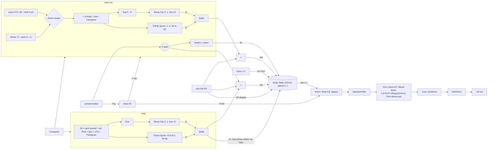

# Aliasing Synth (Reaktor UL #5241): sources, structure, port hypotheses

Date: 2026-11-24. Research only; nothing is ported yet.

Evidence markers: **[sourced]** = from a linked external source. **[observed]** = seen in a screenshot or
in the bytes/strings of the original `.ens` (file or offset cited). **[inference]** = a conclusion that has
not been tested. **[open]** = the user must check it in Reaktor.

## Summary

- "aliasing Synth" is by **Dietrich Pank**. It was created 2008-09-18 as UL version 1.0, made with
  "Reaktor 5 or lower", with 38 snapshots and 5 voices **[sourced]**. The file is named "Aliasing Synth 515". The
  UL does not explain the "515" **[open]**.
- The UL terms let the uploader keep the copyright. They give downloaders no explicit licence **[sourced]**.
  A port that ships the original's code or tables needs the author's permission. A clean-room re-implementation
  with attribution is the safe route **[inference]**.
- Core mechanism **[observed]**: there is one 2-D Audio Table, 1024 x 5 (one row per voice) with a value range
  of 0..1. Each voice writes the **read pointer's own phase** (not audio) into the table at the write pointer's
  position. It reads the table back at the read pointer's position. Output is `2*table - 1`.
- The two pointers are separate oscillators. Each can be a Ramp Osc (labelled "hi" quality) or a Tri/Par
  Symm (labelled "lo" quality, which allows bidirectional and skewed traversal). Each has its own pitch, fine
  tune, a polyphonic event LFO and a voice spread. Both run from a constant base pitch of 60 with no MIDI
  pitch, so the instrument is a drone that starts when the "activate" all-voice gate is switched on.
- The "error" sound comes from the speed ratio `k = f_read / f_write`. It acts like phase-feedback
  waveshaping. Table cells are rounded down on write and skipped when a pointer moves more than one cell
  per sample. The ramps are non-band-limited, and pitch is quantised to the control rate (the ensemble is
  saved with 48 kHz SR and a 400 Hz control rate) **[inference]**, partly **[observed]**.
- The post chain per voice is: Peak EQ ("Notch", with a positive or negative boost) → "SaturatorFilter"
  (HP4 with linear FM → drive → Saturator → LP4 with linear FM → 1-pole DC blocker → drive → Saturator)
  → per-voice pan → sum, with a −14 dB voice-count compensation **[observed]**.
- scsynth thread (2024): Santi Vilanova (Playmodes), Eric Sluyter, Thor Madsen and Paul (TXMod) built a
  SuperCollider approximation. It had the right "family" of sound but was never verified against the
  original. Gaps: unipolar/bipolar range errors, no notch, no triangle pointers, no control-rate stepping,
  and a different filter and saturator **[sourced]**.
- Most sensitive for a port: the Audio Table properties (X units, clip/wrap, read interpolation), the
  write-position rounding, value clipping to 0..1, the Ramp Osc mode (non-AA), whether Tri/Par Symm is band
  limited, control-rate stepping of pitch/LFO, sample rate, and the Saturator curve and 4-pole filter
  topology. Most of these are **[open]**. A capture list for the user and a reference-render plan follow below.

## Inputs used

| Input | Path / URL | Notes |
|---|---|---|
| Original UL download (only port reference, user decision 2026-11-24) | `devices/aliasing/reference/reaktor/Aliasing Synth 515 (original 2008).ens` | 144,346 bytes, dated 2008-09-18, SHA-256 `62ec413e5947b5d5…` |
| Screenshots (25 PNGs, taken 2026-11-24) | `devices/aliasing/reference/reaktor/screenshots/` | cited below by their time stamp, e.g. `15.52.50` = `Bildschirmfoto 2026-11-24 um 15.52.50.png` |
| User notes | `devices/aliasing/reference/reaktor/description.txt` | the UL description and 3 URLs |
| Two 2023 copies saved by Reaktor 6 inside Live projects | same folder | excluded by user decision. Only noted: they carry the same strings and different host tempo fields |
| scsynth thread and its 6 Reaktor screenshots (Santi, 2024-02-24) | see Sources | read via the Discourse JSON API, all 20 posts |
| UL page | archived 2022-08-22 (Wayback) | the live page `userlibrary.native-instruments.com/reaktor/item/5241` returns HTTP 403 to automated fetches |
| dogsonacid thread | — | HTTP 403 and no Wayback snapshot. Only search-engine snippets were available |
| Reaktor 5.5 Module Reference / Application Reference, Reaktor 6 Building in Primary | NI manuals (PDF) | used for module semantics |

## 1. Provenance

- **Title / author:** "aliasing Synth", tagline "error is nice", author **dietrich pank** **[sourced: UL
  archive]**. The original `.ens` contains the instrument info "Instrument anbd sounds: Dietrich Pank" and the
  UL description as the instrument's info text **[observed: strings of the original]**.
- **Dates / version:** created 2008-09-18, version 1.0, "Updated 13 years ago" as of the August 2022 archive
  (so roughly 2009) **[sourced]**. The file timestamp of the original download is 2008-09-18 **[observed]**.
  No later UL versions were found.
- **"515":** it appears only in the file name "Aliasing Synth 515.ens". The UL version is 1.0. Santi's 2024
  screenshot breadcrumb also shows "Aliasing Synth 515" **[sourced]**. Its meaning is unknown **[open]**.
- **Reaktor version:** "Made with: Reaktor 5 or lower" **[sourced]**. The original has a pre-R6 header (`KEnsemble`
  chunk, no `hsin`/`DSIN` container) **[observed: bytes 0x00–0x30]**. The saved ensemble settings are sample rate
  48000 Hz (`80 bb 00 00`), control rate 400 Hz (`90 01 00 00`) and tempo 120.0 (`00 00 f0 42`) **[observed:
  bytes 0x26–0x38]**. Leftover sample paths `D:\sounds\…` (Vokator, Battery 2) suggest the author worked on
  Windows. They are not used by the synth **[inference]**.
- **UL stats (2022 archive):** 98 votes, about 4.4K downloads, 32.7 kB download, category Instrument / Synthesizer,
  tag Experimental, 37 comments **[sourced]**.
- **Description:** it repeats the user's `description.txt` (the table is read and written at different speeds;
  "careless" speeds produce errors; 5 voices; Hipass+FM, Lopass+FM and a Notch) and adds that 38 snapshots
  are included **[sourced]**. The original contains about 38 named snapshots in "Bank 1" ("quak", "seti
  filtered", "machine room", "Zug h[ält]", "saw (turn write osc - fine)", "kernel (turn read - fine)", "killer
  bass", "Bomba (turn lopass and Transp.)", "Berliner Ring 2050", "stasi 0.9", "field (re-activate to
  sync)", "flashs (re-activate to sync)", …) **[observed: strings]**. The snapshot shown in `15.50.59`
  ("049 Ghost in the Maschine 2") is **not** in the original file **[observed]**. It probably comes from a
  later save **[open]**.
- **Comments (UL):** mostly praise (Simon Stockhausen, Ned Bouhalassa and others). Recurring requests: envelopes,
  playable "like a synth", and a randomise feature. One user asks whether anyone got a "normal" sound out of it.
  The author replies with thanks. In 2021, Jacques Lochet mentions using the "Zug hält" preset in an
  electroacoustic piece **[sourced]**. No technical explanation is given in the comments.
- **Demos:** YouTube "Aliasing | Native Instruments Reaktor Community Library | Free Synth Plugin" by
  channel "Julian Doe" (ID `Lls_SK-xayY`), linked in the scsynth thread **[sourced: oEmbed]**. The date and
  description were not retrievable.
- **Licence / terms:** the NI User Library terms say that the uploader keeps copyright, that uploads must be
  the uploader's own, that NI gets a non-exclusive marketing right, and that commercial selling is excluded
  **[sourced]**. There is **no** licence grant to downloaders and no attribution clause **[sourced]**.
  Consequences **[inference]**:
  - Do not redistribute the `.ens`, the snapshot values or the stored table data.
  - A functional re-implementation (ideas and an algorithm description are not copyrightable as such)
    with clear credit ("after Aliasing Synth by Dietrich Pank, Reaktor UL #5241") is the defensible route.
  - Asking the author for permission or a licence is advisable before a public release, especially if
    preset values are reproduced.

  The author contact is **[open]** (UL profile "dietrich pank").

## 2. Community knowledge

### scsynth.org thread "Replicating 'Aliasing Synth'…" (20 posts, 2024-02-23 → 2024-03-04) [sourced]

1. **Santi** (Santi Vilanova, Playmodes) opens the thread. He quotes the UL description and links the YouTube
   demo.
2. **Eric_Sluyter** posts a baseline: a 5-channel `Buffer` of 1 s. `SinOsc` sources with `LFDNoise3`-wandering
   frequencies are written via `BufWr` at a `Phasor` rate of 1 and read via `BufRd` at a `Phasor` rate of 100,
   then sent to `Splay`.
3. **Santi** maps the two phasor rates to the mouse and says rate tweaking "captures the essence". From the
   Reaktor structure he lists the differences:
   - the **read position signal is also the write signal**;
   - both pointer rates are modulated by a multichannel (per-voice) LFO;
   - the pointers are **asymmetric triangles** that skew from saw to triangle to inverted saw, which allows
     reading in either direction;
   - the saturator filter is HP4 and LP4 in series with heavy saturation;
   - a notch EQ comes before it.

   He posts 6 Reaktor screenshots (panel, top level, write osc, Audio Table, Notch, SaturatorFilter).
4. **Santi** posts a first saturator: `BHiPass4` (with drive gain, then `tanh`) → `BLowPass4`, where the input
   × amount is added to the cutoff in Hz as FM, then `LeakDC` → `tanh`.
5. **Santi** combines both ("yesssss"). Pitches go through `midicps`, there are per-voice LFO frequency arrays,
   and the output is ×0.1.
6–9. **Thor_Madsen** suggests a `LocalBuf` inside the SynthDef. Santi adopts it.
10. **Santi**, final version: `LocalBuf(1024, 5)` ("restricting it to a size of 1024 like the original").
    `BufWr.ar(readPos, b, writePos)`, so the read position is written. Rates come from the mouse (0–5 for
    both). Output goes through a limiter. He hears "very interesting periodic artifacts". He calls the readPos
    write "some sort of feedback". The code went into `PlaymodesStudio/oceanodeSynthdefs`.
11–13. The repository was made public. Santi asks how to make the asymmetric triangle ("tri/par symm").
14. **Eric_Sluyter** proposes `VarSaw` with a width parameter, scaled to frames. Important point: **keep
    the written read position bipolar (−1..1) and only remap with `.range` for indexing**.
15–18. **TXMod (Paul)** proposes a looping `Env` with a variable segment proportion as the asymmetric
    triangle, and a curve-modulated variant.
19–20. **Thor_Madsen** says he does not understand where the aliasing comes from. TXMod explains that
    sharp-cornered waveforms (`LFSaw`, `LFTri`) alias at high frequencies, while band-limited `Saw` does not.

**Conclusions from the thread [sourced + inference]:**
- **Succeeded:** the core idea (two phasors at different rates, read position written into a 1024 x 5 buffer)
  and a serial HP4→LP4 saturator with audio-rate FM. These give the right family of sound.
- **Not done or wrong compared with the original (checked against the screenshots here):**
  - Santi's final version writes the read position in **frames (0..1024)**, not as a normalised phase. The
    original writes a 0..1 phase into a 0..1 table and outputs `2v−1` **[observed `15.54.13`, original bytes]**.
  - No asymmetric/bidirectional pointers.
  - No notch.
  - The saturator is `tanh` with a different gain staging, not Reaktor's Saturator (±2 limit).
  - The filters are BHiPass4/BLowPass4, not Reaktor's Multi/HP and Multi/LP 4-Pole FM.
  - No control-rate stepping of pitch and LFO.
  - `Phasor` rates are given in frames per sample, not pitch→Hz.
  - No per-voice table rows: SuperCollider's multichannel buffer happens to map voices to channels, which
    is equivalent.
  - No A/B against Reaktor renders.
- Santi's screenshots show a **simpler variant** than the original download. It has no "activate", "reset",
  "Qulity" switches, size bar or AT view. The Audio Table's W input is tied to a constant 1. The write osc is
  Tri/Par Symm only, and the notch is a plain Peak EQ with Boost −30 **[sourced: scsynth images]**. Whether that
  is an edit by Santi or another release is **[open]**. The original 2008 file already contains the extended
  structure (strings "activate", "Qulity", "AT view", "size bar") **[observed]**.

### dogsonacid.com "introducing: aliasing synth - reaktor synth for sick drones & reeses" (thread 690224)

The page returns HTTP 403 and has no Wayback snapshot. Search-engine snippets only **[sourced, unverified]**:
- the thread is over 15 years old (so roughly 2008–2009);
- it describes "very harsh modulated, bassy tones" and says the synth is not exactly "musical";
- it says the synth was **not MIDI-controlled**;
- another user points to a separate "Mr Alias Synth" that can be played with MIDI notes. No UL entry with that
  name was found.

The full thread is **[open]**: the user should open it in a browser and save it as PDF or text.

### Other sources

No KVR, Reddit or NI-forum discussion specific to this ensemble was found. Searches only turned up generic
"aliasing in Reaktor" threads.

## 3. Structure analysis

### Screenshot index

| File (`screenshots/Bildschirmfoto 2026-11-24 um …`) | Shows |
|---|---|
| `15.50.59` | Instrument panel (snapshot "049 Ghost in the Maschine 2"), with tooltip "New, empty macro…" over the read LFO |
| `15.51.10` | Ensemble level: instrument "aliasing Synth" with Out 1/2 to audio out 1/2 |
| `15.51.27` | Instrument top-level structure |
| `15.51.39` | `read` macro |
| `15.51.59` | `read > LFO` |
| `15.52.06` | `read > LFO > voice0-1` |
| `15.52.16` | `read > Osc` (Ramp Osc and Tri/Par Symm) |
| `15.52.23` | `read > Osc > from last Gate` (Hz display) |
| `15.52.50` | `write osc` macro (Event-Merger tooltip over "M") |
| `15.52.58` | `write osc > stereo` (Voice Info "V" tooltip) |
| `15.53.07`, `15.53.14` | `write osc > LFO`, `> voice0-1` |
| `15.53.28`, `15.53.34` | the same `write osc > LFO` / `voice0-1` again (Freq tooltip; clean view) |
| `15.53.47` | `size bar` (XY panel element) |
| `15.53.57` | `Macro` (view switch: Snapshot → Hold 22 → Separator → toggle) |
| `15.54.06` | `AT view` (two Audio Table macros, Switch, Voice Info → RWY) |
| `15.54.13` | `AT view > line view` (Audio Table with `X+` output scaling) |
| `15.54.21` | `AT view > 2D view` (identical structure, different panel style) |
| `15.54.32` | `Notch` (KeyTrack → Peak EQ, bypass switch "on") |
| `15.54.39` | `Notch > KeyTrack` |
| `15.54.50` | `SaturatorFilter` |
| `15.55.00` | `from voice>LR` (per-voice pan and level, voice combiners) |
| `15.55.08` | `Switch2x2 I/O` (L/R vs. unused L2/R2 "Beat Loop" inputs) |
| `15.55.16` | `Button (2-mode)` (the "reset" XY button sends −6 via an IC send) |

Additional references are Santi's 6 images (scsynth post 3): the panel with snapshot "039 horizon", a
simplified top level, write osc, Audio Table (W = 1), Notch, and SaturatorFilter at higher resolution. They
are cited as **SC-panel / SC-top / SC-write / SC-AT / SC-notch / SC-sat**.

### Panel controls (from `15.50.59`; info texts from the original's strings)

| Section | Control | Shown value | Behaviour / range |
|---|---|---|---|
| header | snapshot list, A/B, "MIDI OSC" indicator | 049 | — |
| write osc | **active** (button) | on | info: "on: reading while writing / off: reading only". W = `Not(G) × active` **[observed `15.52.50`]**. Per the R5 manual the NOT module's "Not" output passes a positive input as 1, so W = gate AND active **[sourced manual]** |
| write osc | **reset** (button) | — | copies pitch/fine between write and read (IC sends `>read PIC`, `>write PIC`, `>write fine`). Snapshot names "(turn … - fine)" suggest that a detuning from a synced state is the playing gesture **[inference]** |
| write osc | **Qulity** (switch hi / lo) | lo? | hi = Ramp Osc, lo = Tri/Par Symm **[observed `15.52.50`]**. Info: "on: precise reading / off: bidirection possible" |
| write osc | LFO **Freq** / **Amt** | 1.9 / 100 | event LFO ("polyphone LFO"). Amplitude = Amt^5 semitones. The display shows Amt^5 × 100 **[observed `15.53.07`]**. Knob ranges **[open]** |
| write osc | **In-Pitch** | −36.5 | semitones, added to 60 |
| write osc | **fine** | 0 | semitones (range **[open]**) |
| write osc | **lo Qu** | — | Tri/Par Symm W (symmetry −1..1) of the write pointer |
| write osc | display "Frq" | 15.7 | write pointer frequency in Hz of the "last" voice. Check: 60 − 12 − 36.5 = 11.5 → 440·2^((11.5−69)/12) ≈ 15.9 Hz, ≈ 15.7 with LFO **[inference]** |
| read | LFO **Freq** / **Amt** | 0.2 / 100 | as for write. The read LFO output waveform is hidden by the tooltip in `15.51.59` **[open]** |
| read | **sprd** | — | per-voice pitch spread: `sprd·((V−0.5)/Vcs − 0.5)` semitones, i.e. ±0.4·sprd for 5 voices **[observed `15.51.39`]** |
| read | **out Pitch**, **fine** | ?, 0.124 | semitones |
| read | **Qulity** | — | hi = Ramp, lo = Tri/Par Symm (as for write) |
| read | **>>/< >** (dir) | — | Tri/Par Symm W of the read pointer. Info: "with low Quality: off one direction read / on: bidirection read". Button values (probably ±1 / 0) **[open]** |
| table | waveform display + **size bar** | — | an XY used as a slider (info "sample resolution"). Its MX output multiplies **both** pointer signals and drives the table display range XR **[observed `15.51.27`, `15.53.47`]**. Value range **[open]** |
| table | **view** | — | switches line view / 2D view (Switch in AT view). Display only |
| — | **activate** | — | "all-voice-Gate on". Triggers base pitch 60, gates both oscillators (Ramp sync), and multiplies the read pointer (read position = 0 when off) **[observed `15.51.27`]** |
| SaturatorFilter | **/HP** + Reso + FAmt | 36.7 (Hz) | HP4 cutoff pitch (the display shows Hz via Exp). FAmt = linear Hz FM by the input |
| SaturatorFilter | **LP\\** + Reso + FAmt | 349.2 (Hz) | LP4, likewise |
| SaturatorFilter | **Drv** | — | dB gain into **both** saturators |
| SaturatorFilter | on (LED button), **−DC** | — | bypass, and selection of the 1-pole HP vs LP output (P unconnected = 8.18 Hz) **[observed SC-sat]** |
| Notch | **Frq** | 185 (Hz) | Peak EQ cutoff (KeyTrack: `(P−60)·Kfolw + Cut`; P is constant 60 → Cut) |
| Notch | **Boost** | 16.5 | dB. Positive values make it a peak; Santi's snapshot uses −30 (notch) |
| Notch | Reso, K folw, on | hidden? | Peak EQ Res (Q ≈ 1/(2−2·Res) **[sourced manual]**). Whether K folw has a panel control **[open]** |
| global | **Transpose** | −12 | added to both pointer pitches (P+−) |
| global | **stereo** | 0.46 | pan spread: 0 mono, 1 even L→R, 2 "more extreme" (info text) |
| global | **OUT** fader + small "reset" button | −3.8 dB | the button sets the fader to −6 dB ("2-Mode button, made by mAtze") |

### Signal flow (per voice; 5 voices assumed)

Text version:
`activate → (P=60, G)`
`→ write pointer = Q_w(osc_w(60+LFO_w+Transpose+In-Pitch+fine)) × size`
`→ read phase φ_r = Q_r(osc_r(60+sprd·s_v+Transpose+outPitch+fine+LFO_r))`
`→ AudioTable[row v−1]: write φ_r at cell ⌊size·φ_w⌋ when G·active`
`→ y = 2·Table[size·φ_r·G] − 1`
`→ Peak EQ → HP4(FM) → Drv → Sat → LP4(FM) → 1-pole DC → Drv → Sat → pan → Σ voices`

### Details per macro

**Top level (`15.51.27`, enlarged crop):**
- **[observed]** `60 → Value`. Value's Trig comes from `activate → M`. Value Out goes to write osc "P" and Notch "P".
- **[observed]** M Out goes to read "G", write osc "G", Value Trig and the upper `X`.
- **[observed]** read Out goes to write osc "rd", AT view "In" (white audio wire passing behind write osc), and
  the upper X.
- **[observed]** Upper `X` = read Out × M (gate) × size bar → RX. Lower `X` = write osc Out × size bar → WX.
- **[observed]** write osc "W" (event) → AT view W. size bar → XR. The `view` Macro feeds AT view's
  panel-switch input and the `sw>` send.
- **[observed]** Notch → SaturatorFilter → `from voice>LR` (Lvl from the OUT fader) → `Switch2x2 I/O` →
  Out 1/2. "Button (2-mode)" is not wired (IC send).
- What "M" is (an event merger with one used input) is **[open]**. It may be a leftover from a MIDI gate merge;
  info texts mention "midiP (midinotes)" and KeyTrack "when playing midinotes", but no MIDI pitch path is
  visible **[observed]**. Whether playing MIDI notes does anything is **[open]**. Per the dogsonacid snippet it
  is not MIDI-controlled **[sourced, unverified]**.

**read (`15.51.39`, `15.52.16`, `15.52.23`, `15.51.59`, `15.52.06`):**
- **[observed]** Pitch = `60 + sprd·((V−0.5)/Vcs − 0.5)` + `P+−` (Transpose) + out Pitch + fine + LFO Out
  (event sum).
- **[observed]** Osc: Exp(P→F) → **Ramp Osc** (F in Hz, A = 1, Snc = G) → Out 1. **Tri/Par Symm** (P, A = 1,
  W = dir) Tri ×0.5 + 0.5 → Out 2. The `Qulity` switch selects. Both outputs are therefore 0..1, because the R5
  Ramp Osc outputs 0..A **[sourced manual]**.
- **[observed]** `from last Gate` is a display of the frequency in Hz via From Voice.
- **[observed]** reset → Separator → Value → IC sends `>write PIC` / `>write fine`.
- **[observed]** LFO: Power(Amt, 5) → A. The F input comes from Freq combined with the voice position (0..1)
  through `+` and `×`. The exact wiring (whether Freq·(1+u) or (u+Freq)·Freq) is ambiguous at this
  resolution **[open]**.

**write osc (`15.52.50`, `15.52.58`, `15.53.07`–`15.53.34`):**
- **[observed]** P → `stereo` (P + sprd·(−1..1)) and constant 60 → `LFO` (Sin·Amt^5 + In) are combined by an
  **Event-Merger** (tooltip), then `+ P+− + fine + In-Pitch`.
- Because the event LFO emits at the control rate, the merger output is effectively always the LFO branch. The
  write-side voice spread ("sprd", not on the panel) would be overwritten **[inference, quirk to reproduce
  or to decide on]**.
- **[observed]** The sum → Exp → Ramp Osc F (A = 1, Snc = G). The sum also → Tri/Par Symm P (A = 1, W = lo Qu).
  Qulity switch: hi = Ramp, lo = Tri. Note there is **no** ×0.5 + 0.5 here: the Tri output is −1..1, so write
  positions can be negative. They are then clipped or wrapped by the table **[open: Clip/Wrap setting]**.
- **[observed]** W out = `Not(G) × active`. Fr.V → "Frq" display.

**AT view (`15.54.06`, `15.54.13`, `15.54.21`; SC-AT):**
- **[observed]** Two Audio Table macros ("line view", "2D view") get identical inputs. RY = WY = `V − 1`
  (per-voice row). YR = Vcs. A Switch picks the output that matches the panel view.
- **[observed]** Output: `X+` = Out × 2 + (−1). The constants sit next to the DX/DY ports but are not connected
  to them.
- **[observed bytes]** In the original, one table header at 0x1a2c4 holds `1024, 5` (X size, Y size) and value
  min 0.0 / max 1.0. The 5 × 1024 float32 cell values are **stored in the ensemble** (0x1a334–0x1f333) and lie
  in 0.0002–0.9998. Each row consists of ramp-like segments with about 90 wrap jumps per row, which fits
  "phase values written at the write head".
- **[inference]** The second table holds no data of its own (only one `1024,5` header exists). It probably
  references or shares the first table.
- **[sourced manual]** Audio Table semantics:
  - values written outside Min..Max are **clipped**;
  - write positions are **rounded down** to a cell;
  - read can be interpolated (off / X / Y / XY);
  - out-of-range positions are **clipped or wrapped** (wrap is the default);
  - XO/XR only zoom the panel display;
  - X units can be Index, [0…1], ms or ticks, and they define how RX/WX are interpreted.
- **[open]** X units (Index vs [0…1]), Clip/Wrap XY, read interpolation, and the meaning of the remaining
  header fields (`24`, `4`, floats `48.0`, `120.0`, `268.0`, `5.0`).

**size bar (`15.53.47`):** an XY panel module (X1/Y1 driven by a self-looped event module "S" through `+`,
Y2 = 1); MX → Out **[observed]**. Its MX range, and therefore whether the pointers span 0..1024 cells (Index
units) or 0..1 ([0…1] units), is **[open]**. This setting decides the whole speed mapping.

**Notch (`15.54.32`, `15.54.39`; SC-notch):**
- **[observed]** KeyTrack C = `(P − 60)·S(K folw) + S(Cut=Frq)` → Peak EQ P. Reso → `S` → Res. Boost → B.
  The "on" switch selects Peak EQ or dry. Exp → Select Max (gated) → "F" display.
- The "S" modules (white input, yellow output) are not identified, possibly smoothers **[open]**.

**SaturatorFilter (`15.54.50`, SC-sat):**
- **[observed]** `In →` Multi/HP 4-Pole FM (P = /HP, F = FAmt_hp × In, Res = S(Reso)) **HP4** → Mixer (Lvl =
  Drv dB) → Saturator → Multi/LP 4-Pole FM (P = LP\\, F = FAmt_lp × **In**, i.e. the unfiltered input,
  Res = S(Reso)) **LP4** → 1-Pole Filter (P unconnected → 8.18 Hz) HP/LP → "−DC" switch → Mixer
  (Lvl = Drv) → Saturator → "on" switch (vs dry In) → Out.
- The macro's info text reads like a stock library "Split filter" macro, adapted **[observed strings]**.
- **[sourced manual]** The Saturator is a smooth symmetric curve, linear for small inputs, with output limited
  to ±2 for |x| > 4. The exact curve is undocumented. The filters' F inputs add Hz linearly to Exp(P), so FM is
  audio-rate and through-zero-capable (can go negative) **[inference]**.

**from voice>LR (`15.55.00`):**
- **[observed]** Pan = stereo × `((V−0.5) − Vcs/2) / ((Vcs−1)/2)` (−1..1). Level = OUT fader +
  Log(1/Vcs) dB (≈ −14 dB at 5 voices). Stereo Mixer → voice combiners "}" → L/R.
- **[open]** Vcs = 1 would divide by zero.

**Switch2x2 I/O (`15.55.08`):** selects L/R vs L2/R2 ("Beat Loop-L/R", unconnected). It is a leftover.
**Button (2-mode) (`15.55.16`):** the OUT "reset" sets −6 dB. **Macro/view (`15.53.57`):** UI only.

### Not visible yet: captures the user should make in Reaktor [open]

1. **Audio Table properties** (both instances, Function and View pages): X/Y size, Min/Max, X/Y units,
   Clip/Wrap XY, **Interpolation**, "Retain/Save table data", Samples/Sec, and any table-reference or sharing
   setting.
2. **Ramp Osc properties** (read and write): Mode (**Standard / Anti-Aliased Sync / Hi-Res**).
3. **Tri/Par Symm**: whether it is band limited (try a high pitch and look at a spectrum). Value of the "dir"
   button (on/off values) and of "lo Qu" (knob range).
4. **All knob ranges and step sizes** (properties of In-Pitch, out Pitch, fine (both), Freq/Amt (both
   LFOs), sprd (read and the hidden write sprd), Transpose, stereo, /HP, LP\\, Reso ×2, FAmt ×2, Drv, Notch
   Frq, Reso, Boost, K folw, OUT).
5. **size bar** XY properties (X/Y range, MX output range) and the event module "S" inside it.
6. **Event LFO** module properties (waveform outputs used) and the read LFO's internal wiring without the
   tooltip.
7. **Instrument properties**: number of voices (expect 5), "Mono" flag, MIDI channel, ensemble sample rate
   and control rate in Settings.
8. The identity of the **"S" modules** (Notch, KeyTrack, SaturatorFilter) and of **"M"** at the top level
   (hover tooltip or properties).
9. The **Saturator** and **Mixer** properties, and the **1-Pole Filter** P (unconnected?) and "−DC" switch
   position.
10. The **Peak EQ** variant (Peak EQ vs Peak EQ FM) and whether K folw / Reso are on the panel.
11. The full **dogsonacid** thread (save as PDF in a browser).
12. **Snapshot values**: a list of the parameter values for 3–5 reference snapshots. Use them privately for
    A/B, do not publish them.

## 4. Port-relevant hypotheses

### Mechanism of the "error" sound [inference]

Let φ_w and φ_r be the pointer phases (0..1), N = 1024 cells and s = size.
- Writing: `T[⌊s·N·φ_w⌋] = clip01(φ_r)`.
- Reading: `y = 2·T[s·N·φ_r] − 1`.

Then:

1. **Synced pointers** (equal pitch after "reset" / "re-activate to sync"): T(x) ≈ x, so y is a plain saw at
   f_r. The snapshot names "saw (turn write osc - fine)" and "kernel (turn read - fine)" point to detuning
   from this state as the main gesture.
2. **Speed ratio k = f_r/f_w.** One write sweep stores frac(k·x + c): a saw with k cycles across the table.
   Reading that at f_r gives a saw at about **k·f_r = f_r²/f_w**, so the output pitch depends
   quadratically on the read speed and inversely on the write speed. On each write sweep the offset c jumps
   by frac(k), which leaves a **phase seam at the write head**. The read head crosses the seam at |f_r − f_w|,
   which adds periodic glitches and sidebands. Tiny changes of k move both the harmonic number and the seam
   pattern. This explains "finest moves in speed cause surprising and dramatic changes".
3. **Cell quantisation and skipping.** The write position is rounded down. When the write pointer moves more
   than 1 cell per sample (N·f_w > fs, i.e. f_w > 46.9 Hz at 48 kHz with s = 1), cells are skipped and keep
   stale values. Below that, cells are overwritten several times. Reading without interpolation gives stepped,
   zero-order-hold output, and reads skip cells as well. All of this is non-band-limited and aliases.
4. **Non-band-limited pointers.** In standard mode the Ramp Osc is not anti-aliased (per the manual this mode
   is meant for table pointers). Its discontinuities pass straight through the table lookup.
5. **Bidirectional / skewed pointers** ("lo" quality): the Tri/Par Symm read can reverse direction. The write
   osc's −1..1 range creates negative positions that are clipped or wrapped, so the write head can sit still
   at cell 0 or fold over. Both create more seams.
6. **Control-rate stepping.** Pitch, fine, LFO and spread are event signals at 400 Hz, so the pointer
   frequency changes in steps every 120 samples at 48 kHz. Because k enters quadratically, the steps are
   audible as "zipper" textures **[inference; check]**.
7. **Per-voice decorrelation.** The 5 voices have different LFO rates (voice index), a read-pitch spread and
   their own table rows. Panned across the stereo field, they produce the "fat" reese and drone character.
8. **Post chain.** HP4 and LP4 with audio-rate linear FM from the raw table signal add more inharmonic
   content. Two drive + Saturator stages compress it into the "ear-candy" texture. The Peak EQ before them
   tames (negative boost) or emphasises (positive boost) one band. This is the source of the "fat"
   character according to Santi **[sourced]**.

### Most sensitive details for a port (ranked) [inference]

1. Table **X units, Clip/Wrap and interpolation**, and the size-bar range: these define the pointer→cell
   mapping and are all **[open]**.
2. **Write rounding** (floor) and **value clipping to [0, 1]** on write **[sourced manual + observed range]**.
3. The **exact pointer waveforms**: Ramp 0..1 with sync on a positive zero crossing of G, Tri/Par Symm with
   W in −1..1, the unscaled −1..1 in write osc vs the 0..1 in read, and the A = 1 amplitude.
4. The **order of read and write within a sample**: does a voice read the cell it just wrote in the same tick?
   This affects the result when the pointers coincide **[open; test]**.
5. **Sample rate**: the original is saved at 48 kHz. All thresholds scale with fs/N, so a port must run at the
   same fs for A/B, or scale the cell math.
6. **Control-rate stepping** (400 Hz) of pitch, LFO and spread. Also the event-merger quirk in write osc.
7. The Reaktor **Multi 4-Pole FM** filters (topology, resonance scaling, FM summing in Hz) and the
   **Saturator** curve (±2 limit). Both need to be measured.
8. The initial table state. The original stores table contents; a port starting from zeros will differ for the
   first write sweep. This only matters for the first seconds.
9. The voice-count gain (−14 dB) and the pan law of Reaktor's Stereo Mixer **[open]**.

### Reference renders needed from Reaktor (for A/B)

Make all renders at **48 kHz**, stereo, with fixed snapshots, LFO Amt = 0 unless stated, and 10 s from
"activate". Render at 44.1 kHz only as a second set, to confirm the sample-rate dependence.

1. **Core only**: Notch off and SaturatorFilter off (bypass switches), 1 voice if possible (or stereo = 0 and
   sprd = 0), both pointers Ramp ("hi"):
   - (a) synced pitch → expect a plain saw;
   - (b) read +1 semitone vs write;
   - (c) ratios k ≈ 2, 3.5 and 30;
   - (d) a slow automated sweep of read fine over ±1 semitone (zipper and sensitivity test).
2. **Core with "lo" quality**: dir off/on, lo Qu at −1, 0 and +1.
3. **Write rate above 46.9 Hz** (cell skipping) vs below. Size bar at 100 % / 50 % / 10 %.
4. **LFO steps**: Amt = 100, Freq slow, to capture the 400 Hz stepping.
5. **Filter/saturator characterisation** with an external test signal. The macro has a single input, so feed it
   via a copy of the macro in a test ensemble:
   - sine sweep through HP4 and LP4 at several Res values;
   - FAmt test with a sine;
   - DC/level sweep through the Saturator (to read off its curve);
   - Peak EQ at a few Boost/Res values.
6. **Full chain** for 3–5 snapshots (for example "quak", "killer bass", "Berliner Ring 2050", "field
   (re-activate to sync)", and "049" from the screenshot), with a written list of every parameter value.
7. Optional: export the Audio Table contents (.ntf/.txt) right after each render, to compare table states
   directly.

## Sources

- NI User Library entry 5241 (Wayback snapshot 2022-08-22):
  https://web.archive.org/web/20220822041615/https://www.native-instruments.com/en/reaktor-community/reaktor-user-library/entry/show/5241/
  (live page https://userlibrary.native-instruments.com/reaktor/item/5241 returns 403 to automated fetches)
- NI User Libraries terms and conditions:
  https://www.native-instruments.com/en/company/legal-information/ul-terms-and-conditions/
- scsynth.org thread (20 posts, via `/t/9054.json`):
  https://scsynth.org/t/replicating-aliasing-synth-a-gem-in-reaktors-user-library/9054
- Santi's code repository: https://github.com/PlaymodesStudio/oceanodeSynthdefs (not inspected)
- dogsonacid thread (not readable, 403):
  https://www.dogsonacid.com/threads/introducing-aliasing-synth-reaktor-synth-for-sick-drones-reeses.690224/
- YouTube demo "Aliasing | Native Instruments Reaktor Community Library | Free Synth Plugin" (Julian Doe):
  https://www.youtube.com/watch?v=Lls_SK-xayY
- REAKTOR 5.5 Module Reference (Audio Table 12.17, Ramp Osc 6.36, Tri/Par Symm 6.9, Saturator 12.1, Logic NOT
  13.11, Peak EQ 10.16, Multi/LP and Multi/HP 4-Pole FM 10.9/10.11) and Application Reference ch. 11 (table
  units, clipping, interpolation): https://www.native-instruments.com/fileadmin/ni_media/downloads/manuals/
  (local text copies in the session scratchpad, not kept)
- REAKTOR 6 Building in Primary (Audio Table and Event Table wrap by default):
  https://docs.native-instruments.com/pdf-guides/REAKTOR_6_Building_in_Primary_English_0419.pdf
- Local: `devices/aliasing/reference/reaktor/Aliasing Synth 515 (original 2008).ens` (strings, header bytes
  0x00–0x38, table header 0x1a2c4, table data 0x1a334–0x1f333); 25 screenshots in
  `devices/aliasing/reference/reaktor/screenshots/`.
